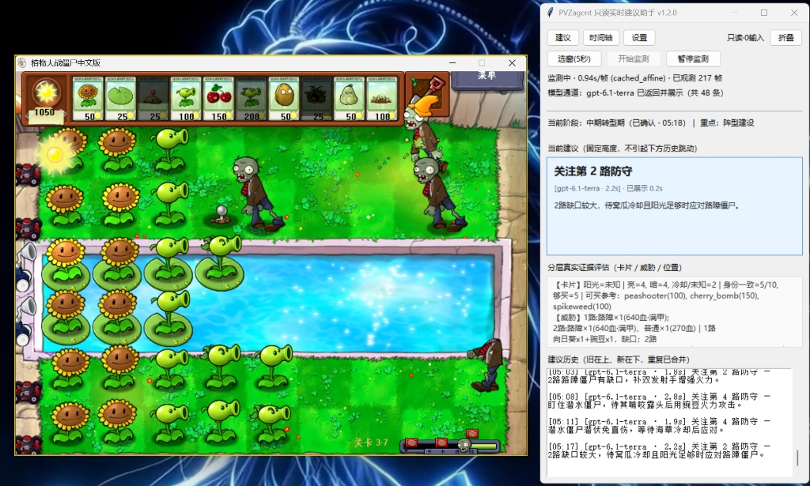
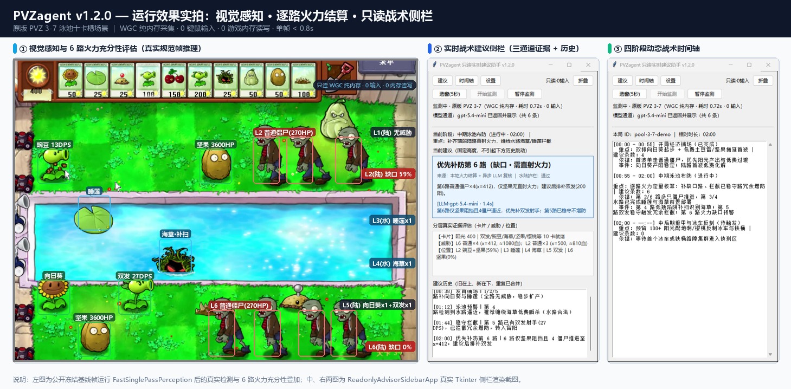
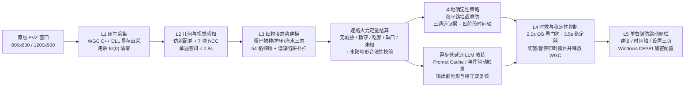

# PVZagent — 纯视觉只读实时战术助手（v1.2.0）


[](LICENSE)

面向原版《植物大战僵尸》（Plants vs. Zombies，重点适配 **3-7 泳池十卡槽** 复杂场景）的 **纯视觉、严格只读** 实时人机协同战术侧栏系统。

---

## 一、30 秒看懂：项目解决了什么问题？

在实时策略游戏的辅助决策与人机协同场景中，本项目聚焦解决三个核心工程与算法问题：

1. **无侵入实时感知（替代外挂式读内存）**：不读游戏内存、不发键鼠输入、不落盘截图像素。通过自研 C++ 原生 **Windows Graphics Capture (WGC)** DLL 纯内存直采显存帧，结合 7 块非数字锚点仿射配准与单遍视觉感知，在单帧 **`< 0.8s`** 内结构化提取阳光、10 卡槽状态、僵尸物种/护甲/姿态与 54 格植物阵型。
2. **抑制策略幻觉与冗余建议（定量物理仿真 + 硬约束护栏）**：
   - **防冗余增防**：内置 PVZ1 逐路火力定量结算器（[`lane_defense.py`](src/pvz_agent/readonly_advisor_v1/lane_defense.py)），按有效射程 DPS、一次性陷阱消耗、潜水露头窗口与坚果缓冲时间判定每路状态（5 档：`无威胁 / 稳守 / 吃紧 / 缺口 / 未知`），**对已稳守路自动拦截重复增防建议**；
   - **防地形幻觉**：在本地规则与大模型输出双侧施加 **3-7 水陆地形铁律**（陆路禁海草/睡莲，水路禁土豆雷/地刺、陆生植物须先垫睡莲），彻底拦截跨地形非法建议。
3. **兼顾大模型推理深度与实时对局体验（本地保底 + 异步低延迟 LLM）**：本地确定性策略与四阶段时间轴实时兜底；异步 LLM 通道采用静态 System/Instructions Prompt Cache 拆分、思考强度自适应降级（`none`/`minimal`/`low`）、事件驱动提前触发与 2.0s 看门狗时效撤回，同时支持一键切回 **0 外网纯本地模式**。

| 核心约束 / 指标 | 实现标准 |
| --- | --- |
| **安全边界** | **0 游戏键鼠输入 · 0 进程内存读写 · 0 截图像素落盘**（帧缓冲用完即 `fill(0)` 清零） |
| **密钥与隐私** | API Key 仅经 Windows DPAPI（`CryptProtectData`）加密存至本机 `%LOCALAPPDATA%`，仓库零凭证 |
| **感知与补扫耗时** | 完整单帧感知 `< 0.8s`；低矮陷阱补扫（海草/地刺/土豆雷）P95 **`< 3.5 ms`** 且 0 误报 |
| **可复现验证** | 59 项 SHA-256 冻结基线离线自检 + 27 项单元测试（**无需安装游戏本体即可一键复现**） |

---

## 二、运行效果实拍

### 1. 实机桌面联机运行（左：原版 PVZ 3-7 窗口｜右：只读实时建议侧栏）

> 系统在零游戏输入、零内存读写的前提下实时观测 217 帧，准确识别 1/2 路路障与普通僵尸（估算血量与满甲状态）、判定 2 路火力缺口，并在历史记录中对 4 路潜水僵尸的「潜伏免直伤 / 露头集火」给出分态对策。



### 2. 视觉感知叠加与四阶段战术时间轴

> 左图为公开冻结基线帧运行 [`FastSinglePassPerception`](src/pvz_agent/readonly_advisor_v1/fast_perception.py) 后的真实植物/僵尸检测与 6 路火力充分性可视化；中、右两图为 [`ReadonlyAdvisorSidebarApp`](src/pvz_agent/readonly_advisor_v1/sidebar_app.py) 的「建议」与「时间轴」界面。



---

## 三、系统架构与数据流



---

## 四、核心模块说明

所有核心产品代码集中在 [`src/pvz_agent/readonly_advisor_v1/`](src/pvz_agent/readonly_advisor_v1/)，职责边界清晰：

| 层级 | 模块路径 | 核心职责与设计亮点 |
| --- | --- | --- |
| **L1 采集** | [`native/pvz_wgc_continuous.cpp`](src/pvz_agent/readonly_advisor_v1/native/pvz_wgc_continuous.cpp)<br/>[`wgc_capture.py`](src/pvz_agent/readonly_advisor_v1/wgc_capture.py) | C++20 静态 `/MT` 原生 WGC DLL（独立 MTA 线程 + 边缘 Alpha 门禁），纯内存抓取窗口客户区，零像素落盘与零进程内存读取。 |
| **L2 感知** | [`fast_perception.py`](src/pvz_agent/readonly_advisor_v1/fast_perception.py) | 缓存仿射几何归一化 + 单遍冻结基线视觉感知，统一汇总资源、卡槽、威胁与棋盘状态，并驱动本地策略输出。 |
| **L3 敌情** | [`zombie_intel.py`](src/pvz_agent/readonly_advisor_v1/zombie_intel.py) | 本地识别 3-7 泳池 6 大核心物种（普通/旗帜/路障受损/铁桶受损/冰车/潜水三态），内置 13 种僵尸图鉴与水陆地形合法性校验。 |
| **L3 我方** | [`plant_intel.py`](src/pvz_agent/readonly_advisor_v1/plant_intel.py) | 逐格识别十卡体系植物（含坚果磨损与土豆雷出土态），并针对海草、地刺、土豆雷做 P95 `< 3.5 ms` 零误报低矮陷阱补扫。 |
| **L3 战损** | [`lane_defense.py`](src/pvz_agent/readonly_advisor_v1/lane_defense.py) | PVZ1 物理机制逐路定量仿真：结算射程 DPS、一次性陷阱、潜水露头窗口与坚果阻挡时间，输出 5 档充分性判定，防止冗余增防。 |
| **L3 教练** | [`async_llm_coach.py`](src/pvz_agent/readonly_advisor_v1/async_llm_coach.py) | 兼容 OpenAI `responses` / `chat_completions`：支持思考档自动回退、Prompt Cache 拆分、可选 SSE 流式、事件驱动触发与地形/稳守双复核。 |
| **L4 运行时** | [`advisor_runtime.py`](src/pvz_agent/readonly_advisor_v1/advisor_runtime.py) | 编排采集-感知-决策主循环、2.0s 看门狗、3.5s 停留稳定器、四阶段动态时间轴与稳守路冗余建议拦截。 |
| **L5 界面** | [`sidebar_app.py`](src/pvz_agent/readonly_advisor_v1/sidebar_app.py)<br/>[`local_settings.py`](src/pvz_agent/readonly_advisor_v1/local_settings.py) | 固定高度 0 px 跳动单右侧可折叠侧栏（建议 / 时间轴 / 设置三页），连接参数通过 Windows DPAPI 加密保存在仓库外。 |

> 补充设计文档：[`docs/侧边栏与战术时间轴.md`](docs/侧边栏与战术时间轴.md) · [`docs/分阶段战术目标.md`](docs/分阶段战术目标.md) · [`docs/失败归因面板.md`](docs/失败归因面板.md)

---

## 五、快速验证与运行

### 1. 环境准备（Windows 10 1903+ / Windows 11 64 位，Python 3.11+）

```powershell
python -m venv .venv
.\.venv\Scripts\activate
pip install -r requirements.txt
```

### 2. 无需游戏本体即可一键复现验证

```powershell
# ① 离线自检：校验 59 项 SHA-256 冻结基线、原生 WGC DLL 与只读安全锁
python scripts/pvz_readonly_advisor.py --self-test

# ② 运行 27 项核心单元测试（涵盖植物/僵尸识别、逐路火力结算、地形护栏、低延迟 LLM 与 DPAPI 存储）
python -m unittest tests/test_readonly_advisor_v1.py -v
```

`--self-test` 预期返回 `"status": "SELF_TEST_PASS"`（`dll_present: true`、`input_sent: false`、`stop_latched: true`）。

### 3. 启动只读实时建议侧栏（配合原版窗口化 PVZ）

双击根目录的 **`启动只读建议助手.bat`**，或运行：

```powershell
pythonw scripts/pvz_readonly_advisor.py
```

1. 点击顶部 **「选窗(5秒)」** 并在倒计时内切到原版 PVZ 游戏窗口（支持 `800×600` / `1200×900` 客户区，可通过 `PVZ_GAME_EXE` 自定义进程路径）；
2. 点击 **「开始监测」** 即可实时输出本地战术建议与四阶段时间轴；如需开启异步 LLM 教练，在 **「设置」** 页填入 OpenAI 兼容 `Base URL` 与 `API Key`（本机 DPAPI 加密记忆，随时可一键切回 0 外网纯本地模式）。

<details>
<summary><b>进阶：从 C++20 源码重新编译原生 WGC DLL（可选）</b></summary>

仓库已附带预编译 64 位 [`pvz_wgc_continuous.dll`](src/pvz_agent/readonly_advisor_v1/native/build/pvz_wgc_continuous.dll)。如需从源码验证编译，在 **x64 Native Tools Command Prompt for VS 2022+** 中运行：

```bat
cl /nologo /c /utf-8 /std:c++20 /EHsc /O2 /W4 /MT /DUNICODE /D_UNICODE /DWINVER=0x0A00 /D_WIN32_WINNT=0x0A00 ^
  /I src\pvz_agent\readonly_advisor_v1\native ^
  src\pvz_agent\readonly_advisor_v1\native\pvz_wgc_continuous.cpp ^
  /Fo:src\pvz_agent\readonly_advisor_v1\native\build\pvz_wgc_continuous.obj
link /NOLOGO /DLL /MACHINE:X64 /INCREMENTAL:NO /MANIFEST:NO /DYNAMICBASE /HIGHENTROPYVA /NXCOMPAT ^
  /OUT:src\pvz_agent\readonly_advisor_v1\native\build\pvz_wgc_continuous.dll ^
  src\pvz_agent\readonly_advisor_v1\native\build\pvz_wgc_continuous.obj ^
  user32.lib d3d11.lib dxgi.lib dwmapi.lib runtimeobject.lib oleaut32.lib ole32.lib
```

</details>

---

## 免责声明与许可

- 本项目仅供计算机视觉、实时人机协同决策与工程安全边界研究学习使用，**不包含任何游戏本体或第三方商业分发包**。
- 本项目严格只读：不读取/修改游戏进程内存，不发送模拟键鼠输入，不落盘截图像素。
- 本项目基于 [MIT License](LICENSE) 开源。
